# Rediseño de la home — a partir del brief del cliente

**Fecha:** 2026-10-26 · **Alcance:** `src/views/HomeView.astro` + `src/content/home-sections.ts`
+ bloque de estilos «10.1 Home editorial» en `src/styles/global.css`.

---

## 1. Lo que pidió el cliente (y dónde está resuelto)

| Punto del brief | Cómo se resolvió |
|---|---|
| Prioridad a los paneles de techo prefabricados | Nuevo **bloque 01 · Sufity dębowe**, justo debajo del hero, sobre fondo oscuro y con la única foto de techo del cliente. Los paneles pasan a ser el **producto 01** de la rejilla de oferta. |
| Dos beneficios concretos de los techos | **01 Montaż bez docinania** y **02 Jedna selekcja na cały sufit**, en lista numerada con filetes. Ambos salen de copy ya publicado (no se inventó nada). |
| Puertas, escaleras y techos como servicios | Nuevo **bloque 06 · Usługi**: Sufity · Drzwi · Schody, con los techos en primer lugar. |
| Lista de precios / cennik | **Bloque 07 · Cennik i wycena**: qué incluye la wycena, enlace a `/cennik/` y CTA al formulario. Se mantiene «bajo petición» (el presupuesto lo prepara el Sr. Artur). |
| E-mail, teléfono, Facebook visibles | **Tarjeta de contacto** en el bloque 07: teléfono, e-mail y Facebook como enlaces directos. |
| Perfil de Google (Wizytówka) | **Pendiente**: no se inventa una URL de Google Business. En cuanto el cliente la facilite, se añade como cuarto canal en `contactChannels` (una línea). |
| SEO / «qué empresa hace los techos» | El H1 sigue con la keyword principal y el eyebrow abre por «Sufity · Ściany · Drzwi». El bloque de techos dice explícitamente quién fabrica (Doors Obłogi) y aporta la prueba (paneles SEDO). |
| Identidad visual premium | Numeración de secciones 01–08, titular y cifras en serif de gran tamaño, filetes de 1 px, fotos a sangre en bloques alternos claro/oscuro, tarjetas de producto a dos columnas y CTA final oscuro. |

---

## 2. Nueva estructura de la home

| # | Sección | Fondo | Para qué |
| # | Sección | Fondo | Para qué |
|---|---|---|---|
| — | Hero | ink + foto | Titular en mayúsculas + 4 hechos + CTA |
| 01 | Sufity dębowe | dark | Producto prioritario, dos beneficios, prueba SEDO |
| 02 | Materiał | dark | Foto + definición + cuatro filas con icono |
| 03 | Rzemiosło | cream | Franja foto · texto · foto |
| 04 | Oferta | paper | Cuatro productos en fila, paneles primero |
| 05 | Selekcja | dark | Dos acabados, dos fotos |
| 06 | Usługi | sand | Sufity · Drzwi · Schody |
| 07 | Realizacje | paper | Cuatro fotos con pie |
| 08 | Cennik i wycena | cream | Qué incluye la wycena + tarjeta de contacto |
| 09 | FAQ | paper | Seis preguntas |
| — | CTA final | dark | Centrada, una acción |

Antes la home tenía 11 secciones sin numerar, 8 607 px de alto en escritorio y 12 396 px en móvil.
Ahora son **9 bloques numerados más portada y CTA**, **9 320 px** en escritorio y **14 062 px** en
móvil. La página crece porque se han añadido dos bloques que el brief pedía (filas de material y
franja de realizaciones); a cambio, cada bloque es más corto y más escaneable, y el peso sigue sin
un solo kilobyte de JavaScript.

---

## 3. Qué se ha ido de la home (y dónde vive ahora)

- **La tabla de trece filas.** Era el motivo de la queja de legibilidad. En la home quedan
  **cuatro cifras** (100 % · 4–8 mm · 2 selecciones · a medida) y un enlace a la ficha, donde la
  especificación completa ya existía. Los trece datos siguen en `src/content/definitions.ts`
  por si se quieren recuperar en el catálogo o en una landing.
- **La sección de colaboración SEDO** como bloque independiente: ahora es la **prueba** dentro
  del bloque de techos, que es donde aporta (y se evita repetir la misma foto dos veces).
- **La sección «Zastosowania»** de seis celdas: sustituida por los tres servicios del brief. La
  lista larga de aplicaciones sigue en `/produkty/`.

---

## 4. Dónde se edita

Todo el copy nuevo vive en **`src/content/home-sections.ts`** (PL/EN/DE), nunca en la plantilla:

- `hero` — eyebrow y entradilla (los techos van primero).
- `ceilings` — título, entradilla, dos beneficios, prueba y CTA.
- `definitionStats` — las cuatro cifras y el enlace a la ficha.
- `services` — los tres servicios.
- `pricing` — cennik, viñetas y CTA.

El orden visual está en `HomeView.astro`; los números de sección, en el campo `index` de cada
bloque (y en el `index` del componente `SectionHead`).

---

## 5. Verificación

```
npm run build   → 40 páginas, 0 errores ni avisos
npm run verify  → 0 problemas; contraste AA en las 14 parejas nuevas
                  (.feature__lead 12,97:1 · .benefit__text 9,11:1 · .stats__label 6,01:1 ·
                   .service__text 4,70:1 · .contact-card__value 16,94:1 …)
_tools/verify-browser.cjs → 0 errores de consola, 1 h1 por página, jerarquía correcta
```

Revisado a 390, 768, 1024 y 1440 px. Sin scroll horizontal.

---

## 6. Pendiente del cliente para cerrar el brief

1. **Cennik real** — lo prepara el Sr. Artur. Cuando llegue, entra en `src/content/pricing.ts`
   y se publica en `/cennik/` sin tocar plantillas.
2. **URL de la ficha de Google** (Wizytówka Google) — hoy no existe en el proyecto; no se
   inventa. Se añade a `contactChannels` y a `company.profiles` (schema.org `sameAs`).
3. **E-mail definitivo** — `kontakt@doors-oblogi.pl` sigue marcado como provisional.
4. **Fotos de techo propias** — la única foto de techo es el collage de SEDO, con rótulos
   impresos. Para el bloque más importante de la página hace falta una foto limpia del techo
   montado (y, si se puede, dos: sin sêki y con sêki).
5. **Confirmar el texto de escaleras** — «Obłóg na stopnie i wykończenie schodów» es la
   formulación más prudente que se puede sostener con lo publicado; conviene que el cliente la
   valide.

---

## 7. Movimiento (2026)

Tres gestos, todos programados, sin una línea de JS de animación y sin librerías:

| Gesto | Cómo está hecho | Dónde |
|---|---|---|
| **Luz recorriendo la veta del hero** | Una máscara de luminancia generada a partir de la propia foto (Sobel direccional, solo componente vertical → conserva las vetas horizontales y descarta las grapas y juntas verticales). La luz es un degradado que se desplaza con `transform` y se compone con `mix-blend-mode: plus-lighter`: suma luz en vez de pintar una capa blanca. | `.hero__grain` + `.hero__grain-band`, máscara en `public/images/grain-hero.webp` |
| **Deriva lentísima de la foto** | `scale(1 → 1.055)` en 34 s, `alternate` | `.hero__media img` |
| **Aparición al hacer scroll** | `animation-timeline: view()` con `animation-range: entry 0% entry 80%`; sin JS. Los titulares y tarjetas suben 1,1 rem; las fotos y las cifras se descubren con `clip-path` | `.section-head`, `.card`, `.benefit`, `.service`, `.contact-card`, `.figure`, `.stats` |

Detalles que importan:

- **La máscara sale de la foto del cliente, no de un patrón.** Se regenera con
  `npm run grain` (`_tools/make-grain-mask.cjs`): Sobel 3×3 sobre los píxeles en crudo,
  normalizado por percentiles, salida WebP de 77 KB. Si se cambia la foto del hero, se
  vuelve a lanzar y la luz sigue la veta nueva.
- **Dos capas de propósito.** La máscara queda quieta (no se repinta) y lo único que se
  mueve es la banda de luz por `transform` (compositor). Animar `background-position` sobre
  una máscara a pantalla completa costaba repintar toda la superficie.
- **`prefers-reduced-motion` desactiva todo**, incluida la deriva; el snippet de scroll va
  además dentro de `@supports (animation-timeline: view())`, así que Firefox sin soporte
  recibe la página completa y quieta, nunca contenido invisible.
- **Nada de contenido que dependa de la animación para verse**: el estado final de cada
  revelado es el estado normal del bloque.

Verificación reproducible con `_design/motion-probe.cjs`: pausa todas las animaciones, fija
la deriva en 0 y coloca la banda en tiempos concretos (`currentTime`), de modo que dos
capturas comparables demuestran el barrido. En el fotograma t=9,5 s las vetas del tablero
superior están iluminadas; en t=0, no.

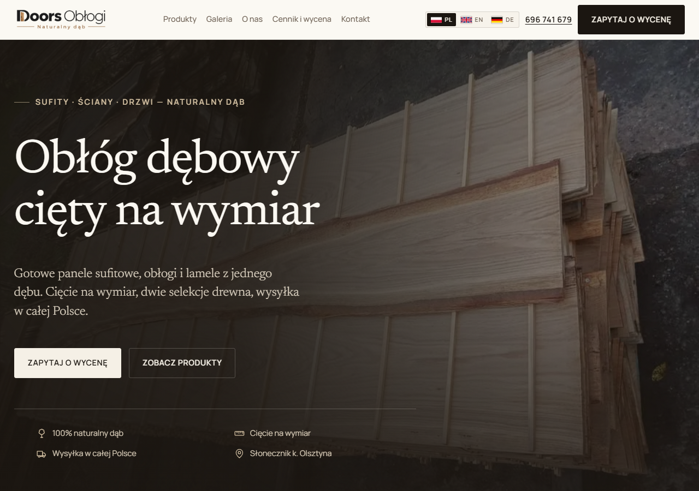
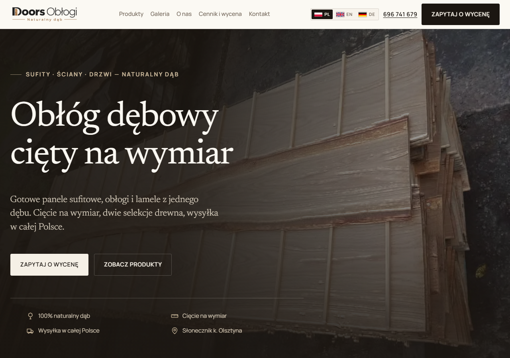

---

## 8. Tipografía (sustitución completa)

Las dos fuentes anteriores — **Newsreader + Manrope** — son la pareja que usan medio internet y
hacían que la web « se notara » generada. Se han sustituido las dos, no solo la sans.

| Uso | Antes | Ahora | Por qué |
|---|---|---|---|
| Titulares, cifras, nombres de servicio | Newsreader | **Fraunces** (variable, ejes `opsz` + `wght`) | Serif de imprenta con detalles caligráficos y eje óptico real: a 88 px afina las finas y gana contraste, a 24 px no se rompe. Da el aire de marca cara sin ser un Playfair de plantilla. |
| Texto, etiquetas, botones, navegación | Manrope | **Archivo** (variable, eje `wght`) | Grotesco de formas cuadradas, algo industrial: sostiene las versalitas espaciadas del sistema sin caer en Inter/Manrope. |

Ajustes que acompañan al cambio:

- `font-optical-sizing` en automático (por defecto): el eje `opsz` sigue al tamaño real del texto.
- Tracking: `-0.012em` en `h1`/`h2`, `-0.01em` en cifras y nombres de servicio. Fraunces a tamaño
  grande lo agradece; el párrafo de la definición se queda sin tocar.
- Prosa y `.lede` suben a `line-height: 1.66` (Archivo tiene una altura de x mayor que Manrope).
- Métricas de reserva actualizadas (`Fraunces Fallback` / `Archivo Fallback`) para que el intercambio
  no mueva el layout.

Peso: **190 KB** en woff2 (Fraunces latin + latin-ext con `opsz`, Archivo latin + latin-ext) frente a
131 KB de la pareja anterior. El extra se paga a gusto: son los dos únicos archivos que definen la
identidad y van precargados (`<link rel="preload">`), con `font-display: swap` y los subsets
`latin`/`latin-ext` únicamente — los subsets cyrillic/greek/vietnamese no se descargan nunca.

Verificado: `npm run build` (40 páginas), `npm run verify` (0 problemas, contraste AA intacto),
`verify-browser` (0 errores de consola) y revisión a 390 / 1024 / 1248 / 1280 / 1440 px, incluida la
cabecera en el punto exacto en que aparece la navegación (78 rem) y las versiones EN y DE.

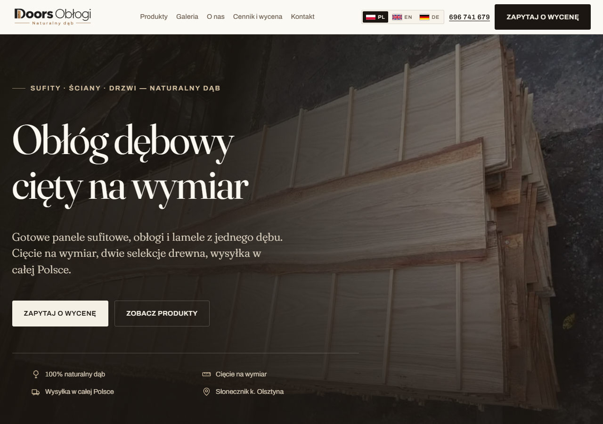
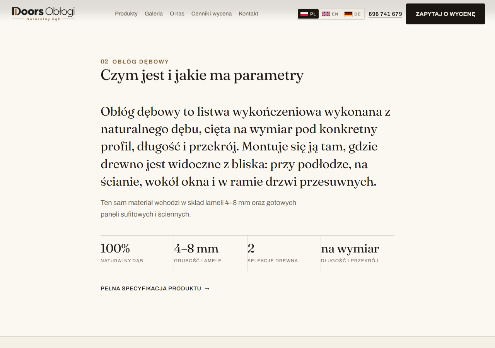
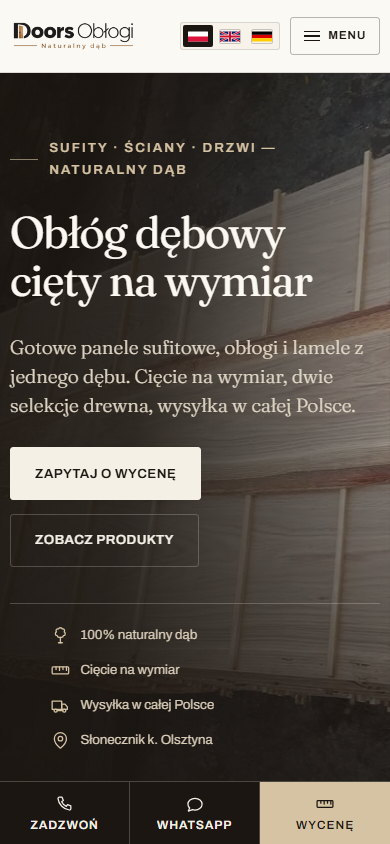

---

## 9. Acercamiento a la referencia visual (OAKCRAFT)

Se toma el lenguaje de la referencia y se aplica **a nuestro contenido**, sin añadir un solo dato
que no estuviera ya publicado.

| Gesto de la referencia | Cómo queda aquí | Contenido |
|---|---|---|
| Titular de portada en mayúsculas, enorme, con kicker pequeño y dos CTA (botón + enlace con flecha) | `text-transform: uppercase` + `letter-spacing: 0.002em` + `line-height: 0.98` en `.hero__title`; la CTA secundaria pasa a `.link-arrow` | «Obłóg dębowy cięty na wymiar» (el H1 de siempre) |
| Banda inferior del hero con datos en línea y filete | La fila de hechos del hero, ya existente | 100 % dąb · cięcie na wymiar · envío · Słonecznik |
| Rejilla de cuatro tarjetas de colección | `.grid-products` a 4 columnas desde 64 rem, foto 4/5 y texto debajo | Los cuatro productos; los paneles siguen en primer lugar |
| Bloque oscuro con foto a la izquierda y filas de icono a la derecha | Nueva sección **02 · Materiał**: `.material` con foto 4/5 y cuatro filas con icono en círculo | Los mismos cuatro hechos de producto, con una línea de apoyo cada uno |
| Franja de tres columnas (foto · texto · foto) | Nueva sección **03 · Rzemiosło**: `.craft` | El texto «Drewno, które widać z bliska» (dos párrafos) + dos fotos del cliente |
| Franja de cuatro realizaciones con pie y enlace | Nueva sección **07 · Realizacje**: `.strip` | Cuatro fotos de la galería con sus pies reales |
| CTA final centrada con un botón | `CtaBand align="center"` (nueva prop) | Titular + texto de siempre; botón principal y teléfono |

Detalles que se mantienen de nuestra parte, porque son la identidad del proyecto: numeración de
secciones 01–09, paleta crema/tinta/roble, filetes de 1 px, fotos cuadradas en la franja, la luz
recorriendo la veta del hero y la tipografía Fraunces + Archivo.

Lo que **no** se copia de la referencia: contadores de slider («01 — 02»), botón de vídeo, iconos
sociales inventados, newsletter y años de experiencia. No hay material ni datos para sostenerlo.

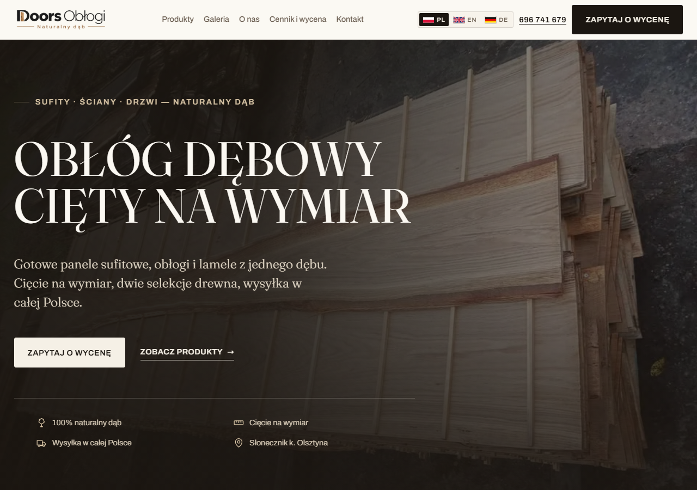
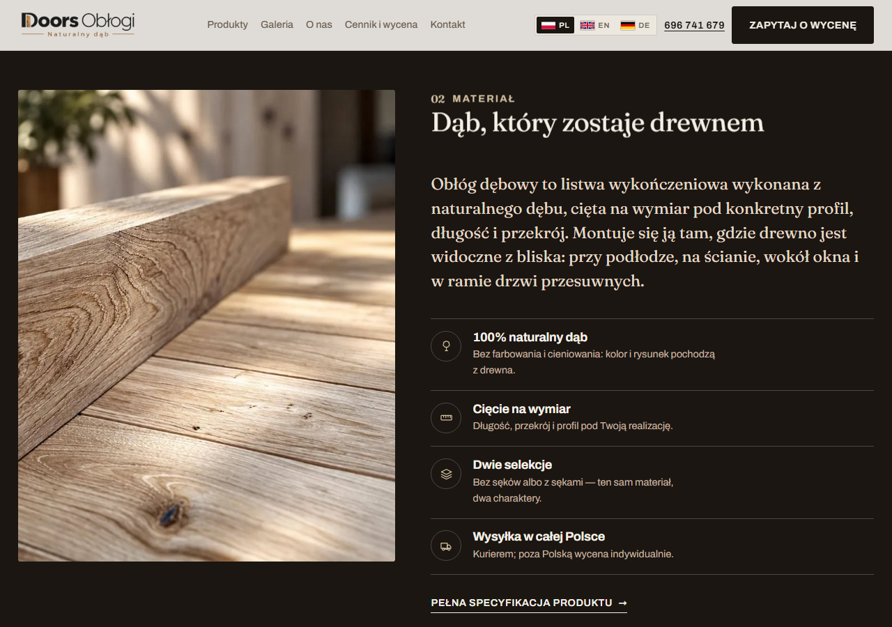
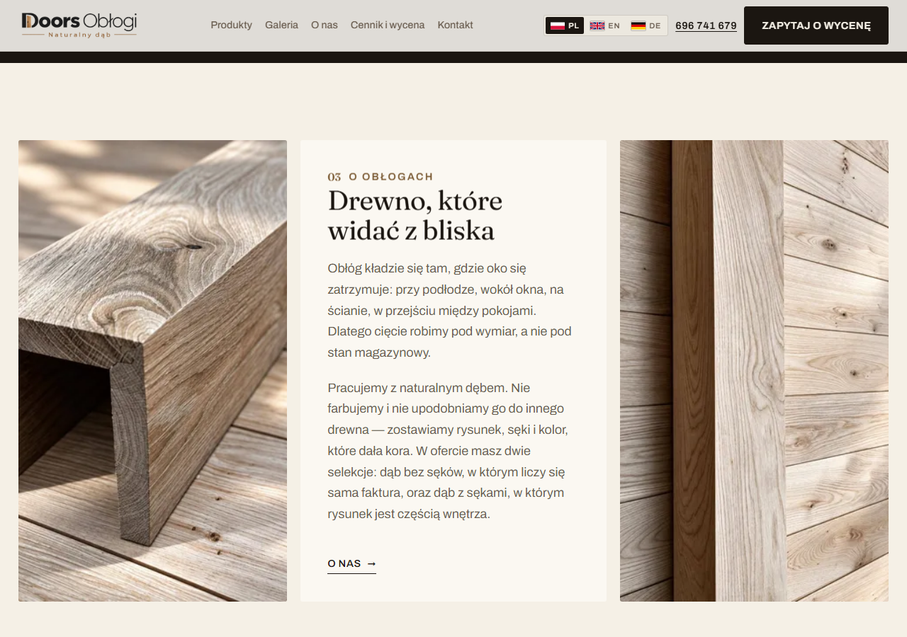
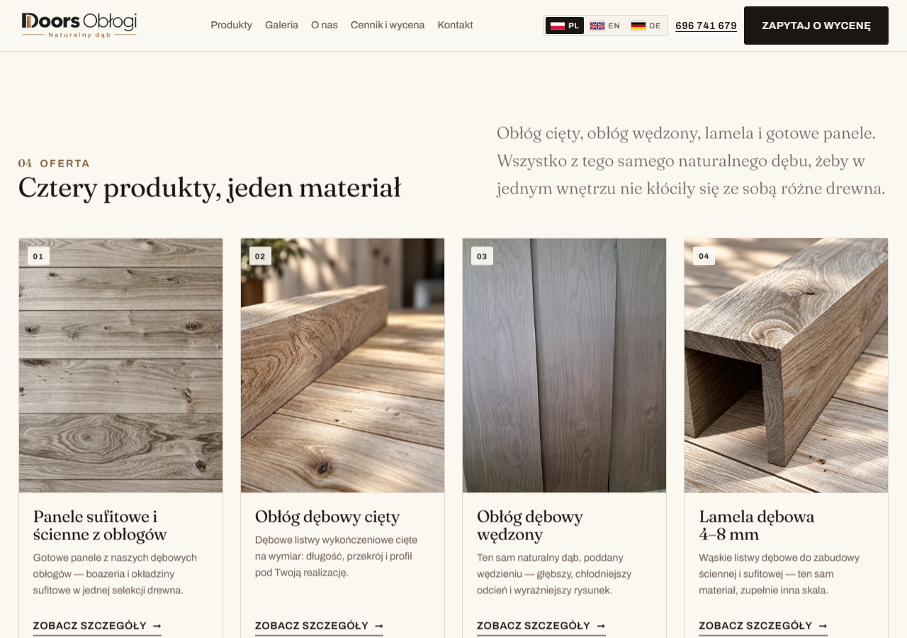
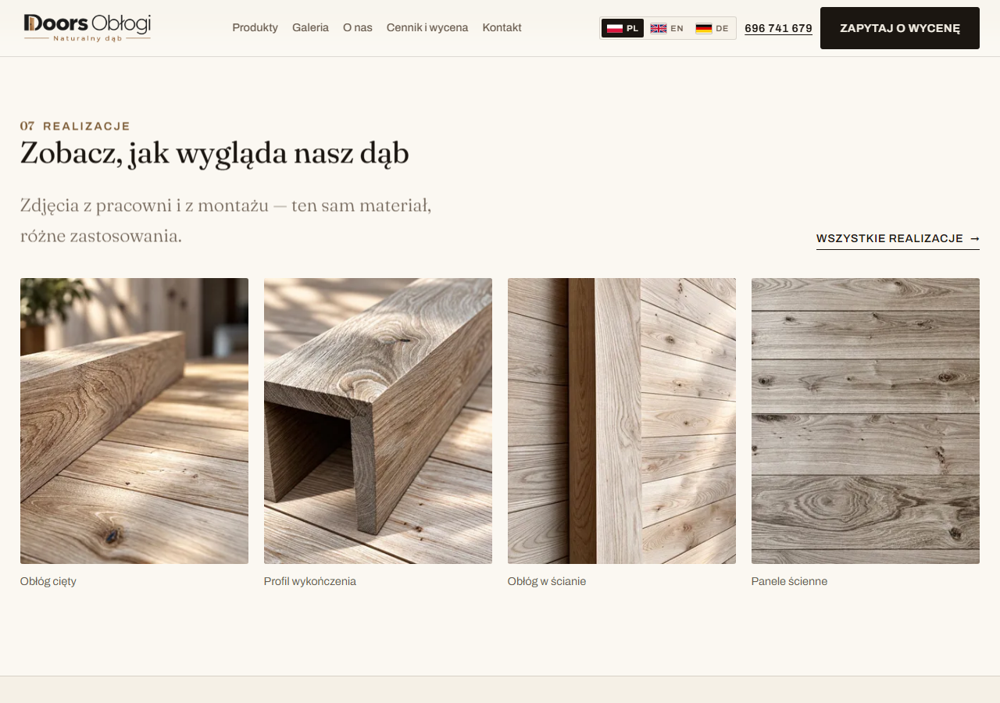
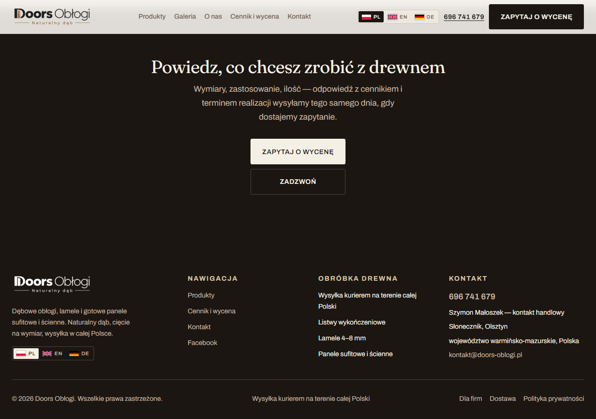

---

## 10. Nueva foto de fondo del hero

El cliente aportó una macro del grano de roble desde una URL externa (1400×785). Sustituye a la
foto anterior del hero, que sólo tenía 960×720 y se veía blanda en pantalla grande.

- Asset: `src/assets/images/hero-sufit-dab.jpg` (1400×785, 317 KB) → WebP 1400 px en build.
- **Máscara de vetas regenerada** con esa misma foto (`npm run grain`, 1400 px, 120 KB), para que
  la luz siga el grano nuevo y no el de la foto anterior.
- El `` declara 1400×785 (mismas proporciones que el archivo) para no mover el layout.
- La foto anterior sigue en el proyecto: se usa como imagen ancha de la galería.

> **Nota de cumplimiento.** `AGENTS.md` regla 2 dice que las fotos son del cliente y no se
> sustituyen por material ajeno. Esta imagen llega por indicación del cliente y queda **pendiente
> de que la confirme como propia**; si no, hay que cambiarla por una foto real del taller o del
> techo y volver a lanzar `npm run grain`.

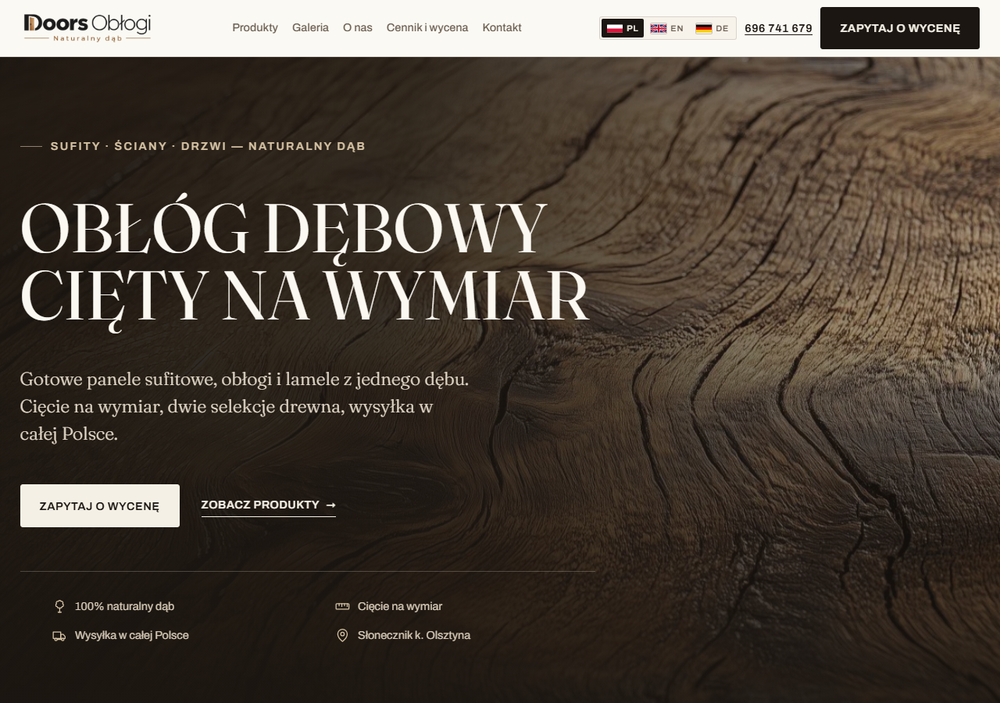
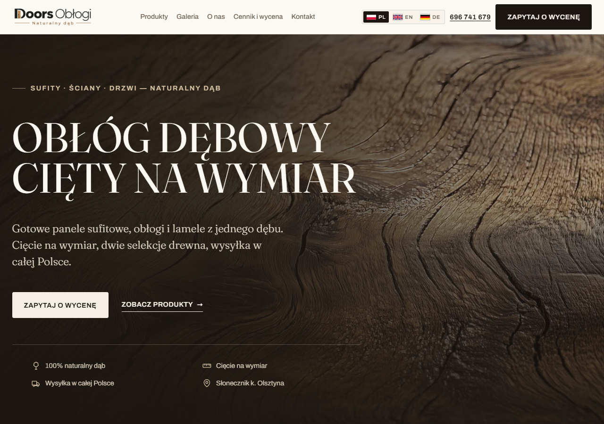

---

## 11. Capa de movimiento pro (GSAP) y stack

### Stack

- **Astro 7** sigue generando HTML estático: el LCP no depende de JavaScript.
- **React** (`@astrojs/react`) instalado y listo para islas interactivas.
- **GSAP 3 + ScrollTrigger** para el movimiento. Se carga como módulo diferido desde
  `BaseLayout.astro` (`src/scripts/motion.ts`).

### Qué hace GSAP (y qué sigue en CSS)

| Efecto | Dónde | Cómo |
|---|---|---|
| Titulares palabra a palabra con máscara | `[data-anim-headline]` (todos los `h2` y el `h1` del hero) | Divide el texto en spans y anima `yPercent` con `expo.out` |
| Entrada de bloques | tarjetas, servicios, filas de material, fichas, contact-card | `gsap.from()` con `once: true` |
| Hero cinematográfico | `.hero__media img` y `.hero__inner` | `scrub`: la foto se acerca y el texto sube y se desvanece |
| **Galería horizontal anclada** | `#realizacje` | `pin` + `scrub` en escritorio (≥62 rem); en móvil desliza con el dedo |
| Parallax de fotos | `[data-parallax] img` | `yPercent ±4` con `scrub` |
| Cursor propio | desktop, puntero fino | `quickTo` + `mix-blend-mode: difference` |
| Textura de grano | toda la página | capa fija con ruido SVG al 5,5 %, `multiply` |
| Luz sobre la veta | hero | sigue en CSS: es independiente del scroll |

### Reglas de seguridad que se respetan

1. **Nada se oculta en el HTML.** Si GSAP no carga, la página se ve completa.
2. **`prefers-reduced-motion: reduce`**: el script sale antes de crear una sola animación
   (verificado: 0 animaciones, 0 cursores).
3. **Sólo transform y opacity.** No se animan propiedades de layout.
4. **El pin respeta la cabecera fija**: el arranque es `top {alturaCabecera}px`, no `top 0`.

### Coste

- Script de movimiento: **112,9 KB sin comprimir · 43,8 KB gzip** (GSAP + ScrollTrigger + código).
- React se instala pero **todavía no lo usa ninguna isla**: el bundle de cliente (66 KB gzip) se
  genera y no lo carga ninguna página. La primera isla prevista es el configurador de presupuesto
  (producto + selección + cantidad → mensaje de WhatsApp), que es lo que justifica React aquí.
- El HTML de la home sigue saliendo del servidor: sin JS se ve todo, y el hero no espera a GSAP.

### Verificado

`npm run build` (40 páginas) · `npm run verify` 0 problemas · `verify-browser` 0 errores de consola
en las 6 rutas de prueba · pin medido con CDP: el track recorre 1 622 px horizontales mientras la
sección queda fija bajo la cabecera y después se libera.
